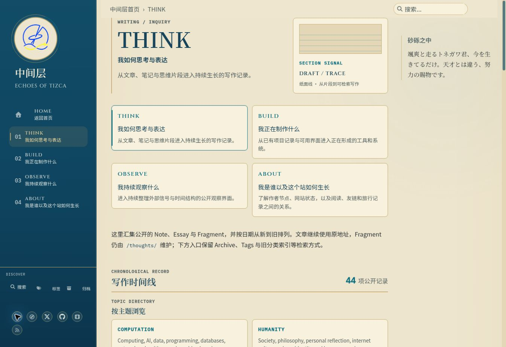
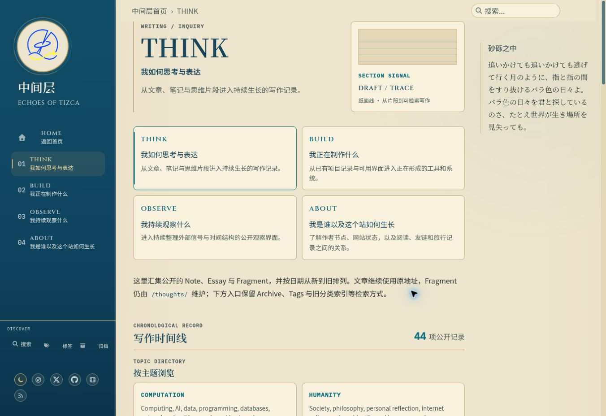
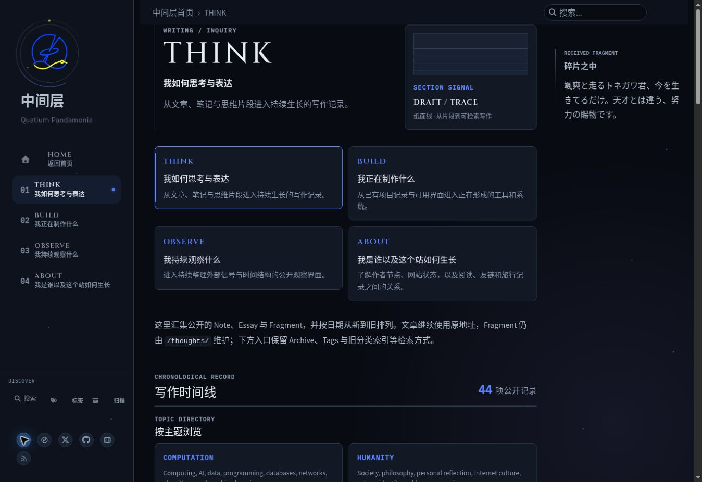
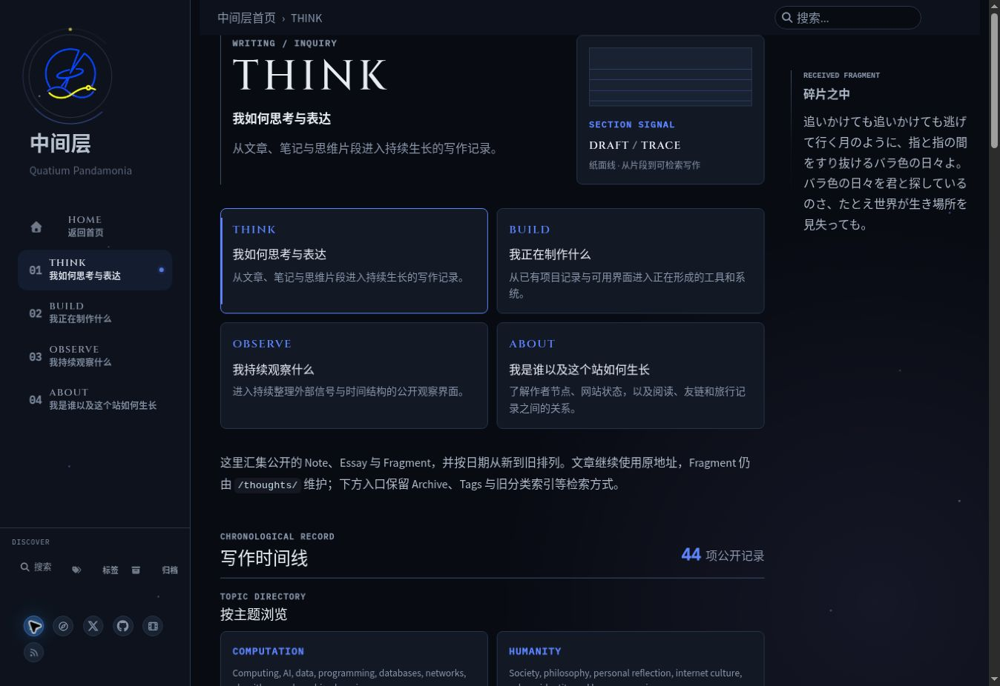

# UI-001 四入口卡片边框对齐

日期：2026-10-14。公开站点Chrome1363×936、THINK、侧栏展开。实际网站截图；右侧随机文本和字体动画可能随访问变化，不是本次修改。

## Light

修复前：同一行THINK/OBSERVE高度122.17px，BUILD/ABOUT144.56px；底部差22.39px。

修复后：4张卡片均144.56px，与各自Grid单元格相同。

## Night

修复前：同样可见不齐。

修复后：4张卡片均144.56px、边框底部对齐。

## 构建浏览器矩阵

[完整导航几何JSON](ui001-navigation-metrics.json)：390/768/1024/1366px × dark/light × 首页/THINK/BUILD/OBSERVE/ABOUT，共40项。所有card/cell上下与宽度差不超过1px，实际最大bottomDifference为0px。视口宽度为Selenium窗口设置，正文扣除滚动条后的宽度可能略小。

[精确head的Actions及40张截图artifact](https://github.com/AplusNeutrino/My_Blog/actions/runs/38500122266)：head0348b33c7e00a5f4584181c8d7244da88fc50244，build/deploy成功；截图artifact11865525942保留14天。已人工查看40项联系表。CI补齐CJK字体，避免环境缺字体造成Night方框；未改产品字体。

范围只涉及导航撑满Grid行与必要门禁维护；没有把导航截图当全站视觉验收。其余页面矩阵继续由本轮计划跟踪。
