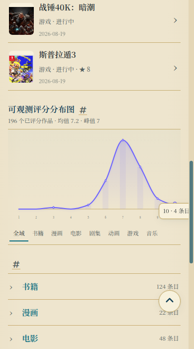
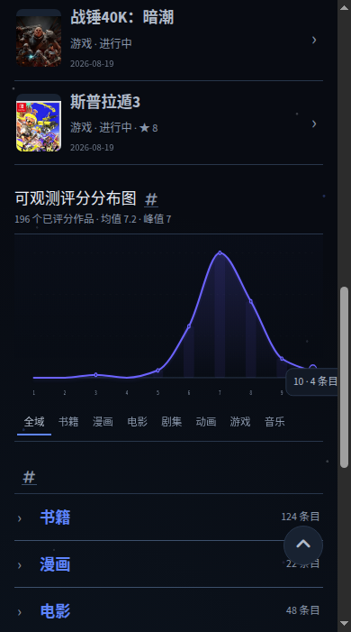

# UI-010：评分末端提示被滚动条裁切

状态：confirmed / validation-pending。2026-10-16实际复现；初始main `3d822d563af3b798a98887d3f35505496931d63c`，复现工作分支head `9d8d3c0869853fd69e4623c50b68ebf1607c8b12`。

复现：Library根页，390×844，Night或Prospero Light；切换全域，用Shift+Tab从全域按钮进入评分10端点。提示“10 · 4 条目”末尾被右侧滚动条裁切，影响完整读数，不是审美偏好。

精确[run38858665322](https://github.com/AplusNeutrino/My_Blog/actions/runs/38858665322) build116836040776 success，deploy116838599413/live116838599804 skipped；229 tests、4 Ruby、T01/authoring/Jekyll/旧门禁与192+14通过，但实际截图否定视觉验收。artifact12029150207 /202758715 bytes，sha256 `83a90b333cd19a8782f7dd36bb0ba469c31860e1fa16410471d930423f1e94ca` 独立匹配。

人工看完整32张评分四状态图两联系表并放大390双主题末端。390 Light诊断tip.right=390.390625、document.scrollWidth=379、innerWidth=390；滚动条占去可用宽，旧几何按innerWidth含滚动条且容差1px误报通过。这是具体门禁缺口，不降低现有门槛。

根因：pgl.js与pgl-rating-polish.js两个既有renderer均只按分箱点百分比设置提示中心，未扣除提示半宽。最小修复显示提示并测量实际宽度，使用CSS clamp让中心在shell边缘内留8px；同时覆盖两个renderer，保留坐标/文本/主题/交互。浏览器审计新增documentElement.clientWidth与shell左右边界断言，原innerWidth、32图、8分类/摘要/真实键盘/刷新及192+14保留。

未修改数据、旧正文/metadata/URL/hidden/noindex或关联仓库。修复后新head production32图与main部署/live同场景尚未验收，保留ui/audit-008h，不合main；不将修复代码存在或单测通过当视觉正常。gh未安装，不创建或编造Issue；无新用户决策。

本地230 tests、authoring44/5/7、T01保护44/5/5及diff check通过；本机未运行Ruby/Jekyll/Chrome，等待新实现head的真实截图。
