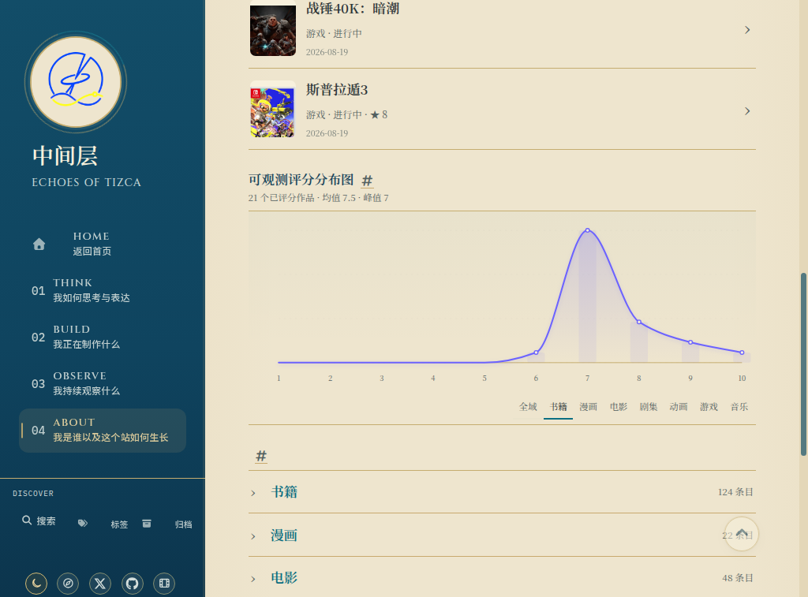

# UI-011：Library目录计数被返回顶部按钮遮挡

当前状态：confirmed / validation-pending。P2。Base/复现main `41dca277eace9aa053bcb87e3cd21892b5ae6390`。下文“未修复/ready”为初次记录，最新实现与验证状态见末节。

证据分类：实际线上截图确认，不是用户偏好或源码推测。1024×900、Prospero Light、Library根页、书籍评分分类；将评分区滚动居中后，下方目录“漫画”右侧计数与固定返回顶部圆钮占据相同位置，被按钮表面和向上箭头遮住。截图来自精确head的[run38871666487](https://github.com/AplusNeutrino/My_Blog/actions/runs/38871666487)线上job116880240197，artifact12033767964内`rating-book-1024-light-library.png`，完整artifact摘要已独立验证。不是只凭DOM推断。

目前没有根因几何诊断、其他滚动位置和四宽度双主题完整专项，因此未修复、未交付产品变更。下一项先以同场景真实浏览器复现并记录计数文字/按钮rect及hit-test，再定位受作用域约束的最小避让策略；不要直接全局隐藏返回顶部、不减小字体或修改目录数据。

拟定范围（定位后收敛）：Library作用域样式、现有真实浏览器审计/必要回归、UI计划日志与本证据；若需共享返回顶部组件改动，必须检查文章与其他页面不回退。验收：390/768/1024/1366双主题滚动不同目录行，真实计数文本不与可见固定按钮相交、按钮仍可点击返回顶部，保留全部既有门禁、T01/authoring/Jekyll及精确main部署/live同场景复验。

gh不在PATH，未创建或编造Issue。无新用户决策，不改旧正文/metadata/URL/hidden/noindex、数据、外部仓库或上一轮COMPLETE。

## 2026-10-16 最小修复与待验收范围

实施base main `600f29073e94b2d8ad17e3365db4c262e9d398f6`；[run38878173427](https://github.com/AplusNeutrino/My_Blog/actions/runs/38878173427) build116898172377/deploy116901351049/live116901426946全部success。本轮云1363×936 Light实际点击书籍评分、滚动目录后看截图并只读测量：计数right1041.8125，按钮left1240.40625/right1284.40625；此宽度计数和按钮无交集。不能调整云视口，不把它当1024/390复测。

源码定位：目录flex space-between把计数推到行右边缘，原行padding未为固定44px按钮预留通道；与已保存1024px截图相符。只在`assets/pgl/pgl.css`的<=1199px（无右侧panel）为`.pgl-category-ledger-item,.pgl-wishlist-entry`增加`padding-inline-end:3.5rem`，沿用既有时间线避让尺度，不改变全局按钮、字号、主题、数据或页面结构。1366px不增加无必要空白。

现有真实浏览器审计新增`library_ledger_controls`：逐个滚动根8计数/愿望单7计数，使目标经过按钮高度（受真实页面长度限制，不伪造页面）；用Range真实文字行判交集、clientWidth判边界。根场景必须按钮可见且hit-test，至少一次目标确实进入按钮垂直带；真实目录进入/返回保持计数、真实按钮点击回顶部。新根目录book/comic/music/wishlist-entry和愿望单首末共48张四宽度双主题PNG/JSON，8组流程；原192+14与全部门禁不删不放宽。

本地233 tests、authoring44/5/7、T01保护44/5/5与diff通过；新增3项仅是作用域/接线回归，不是视觉验收。本机未运行Ruby/Jekyll/Chrome，未取得修复后响应式截图；先`ui/fix-011`，精确head的production192+14/48图/8流程以及main部署/live同场景仍validation-pending。无新用户决策，gh未安装不编造Issue。
