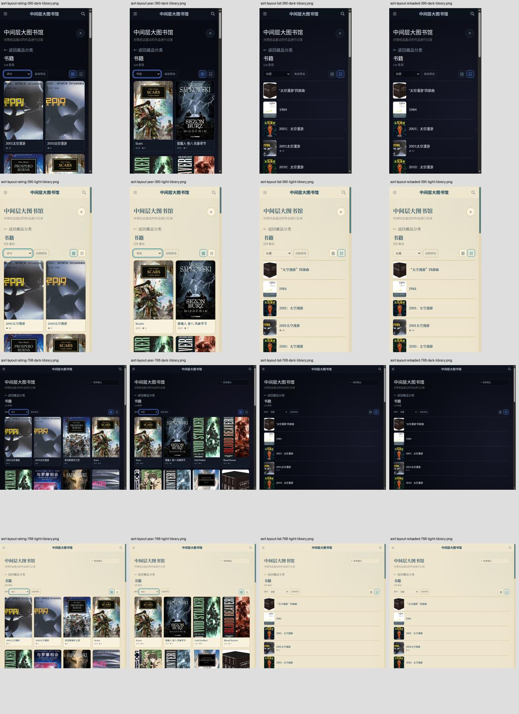
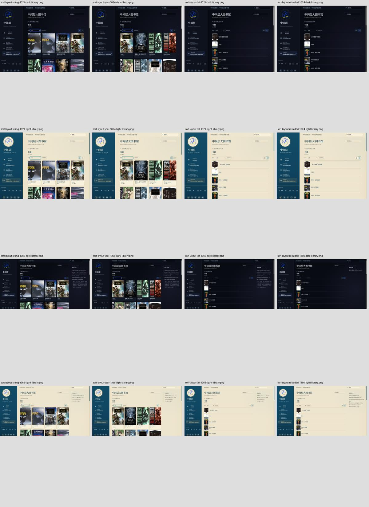

# UI-A08e：Library 排序与列表审计

状态：validation-pending。Base main `5a3b947fd9ea9ad2d6d7135d52b8afbebfcfb9cd`。

2026-10-16云Chrome实际1363×936、Prospero Light：从书籍目录选择评分，再点击列表，刷新后URL仍`?category=book&sort=rating`、列表偏好保持、首项2001太空漫游评分10；最后Enter恢复网格成功。实际截图中封面、标题、评分可见，未确认新产品缺陷。仅此桌面局部观察，不代替四宽度双主题验收。

新增真实Selenium流程：评分/年份在进行中优先分组内降序；标题排序后切换列表保留ID；整页刷新保留URL、ID和列表偏好；Enter恢复网格；默认排序恢复初始ID。每种宽度/主题新增rating/year/list/reloaded四张PNG及实际几何JSON，共32张；严格保留页面/card溢出、scrollX、aria-pressed检查及原192+14。标题不跨Python/JS语言环境强行比较locale排序，只检查刷新稳定性；不声称完整标题排序语义、全部库存、离屏加载、Steam排序或摘置/已放弃已验收。

本地225 tests、authoring44/5/7、T01保护44/5/5、diff check通过。静态接线测试不作视觉证据；本机无Ruby/Jekyll/Chrome，新head production截图/人工查看及main/live未验收。保存工作分支，不改产品、不合main。gh未安装，未创建或编造Issue；无新增用户决策。

## 2026-10-16 生产验收

验收head `b392d508df2e340285694426acdf72abbd0cc63d`，[run38799655164](https://github.com/AplusNeutrino/My_Blog/actions/runs/38799655164) build116645533313 success；deploy116648196476/live116648198287 skipped（工作分支，不当作部署）。225 tests、4 Ruby、T01/authoring/production Jekyll/Search/feed/SEO/资源及192+14通过。

下载artifact12004835019 /171829101 bytes；sha256 `97aad4943c455eaa3152baf3ddff5d3cdb4c8ab9e7e77aeee013156dc8ad5e7e` 独立匹配。人工看以下两联系表全部32张四宽度双主题图，放大390 Light列表、390 Night年份、1024 Light刷新原图，标题/封面/评分和按钮可见，未新增确认产品缺陷。不凭审美偏好改样式。

[完整192 audit](uia08e-production-audit.json)包含8排序/列表流程，评分/年份组内顺序、标题排序刷新URL/ID、列表切换ID、刷新偏好、Enter网格恢复及默认排序恢复全通过。[32几何诊断](uia08e-production-sort-layout.json)无页面/card横向溢出、scrollX=0、pressed状态一致。原PNG留artifact14天，公开联系表与JSON持久保存。

结论限这些书籍排序/列表状态；完整库存/离屏加载、Steam排序、摘置/已放弃与其他全站矩阵仍未验收。生产验收后交付main，状态继续validation-pending，必须实际新main精确build/deploy/live和同32图复验；不把localhost当线上验收。
