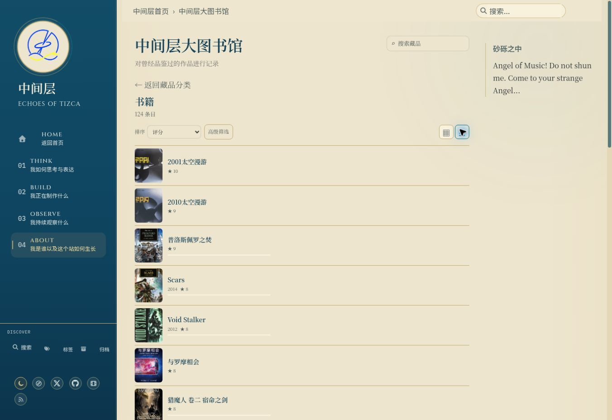

# UI-A08e：Library 排序与列表审计

状态：validation-pending。Base main `5a3b947fd9ea9ad2d6d7135d52b8afbebfcfb9cd`。

2026-10-16云Chrome实际1363×936、Prospero Light：从书籍目录选择评分，再点击列表，刷新后URL仍`?category=book&sort=rating`、列表偏好保持、首项2001太空漫游评分10；最后Enter恢复网格成功。实际截图中封面、标题、评分可见，未确认新产品缺陷。仅此桌面局部观察，不代替四宽度双主题验收。

新增真实Selenium流程：评分/年份在进行中优先分组内降序；标题排序后切换列表保留ID；整页刷新保留URL、ID和列表偏好；Enter恢复网格；默认排序恢复初始ID。每种宽度/主题新增rating/year/list/reloaded四张PNG及实际几何JSON，共32张；严格保留页面/card溢出、scrollX、aria-pressed检查及原192+14。标题不跨Python/JS语言环境强行比较locale排序，只检查刷新稳定性；不声称完整标题排序语义、全部库存、离屏加载、Steam排序或摘置/已放弃已验收。

本地225 tests、authoring44/5/7、T01保护44/5/5、diff check通过。静态接线测试不作视觉证据；本机无Ruby/Jekyll/Chrome，新head production截图/人工查看及main/live未验收。保存工作分支，不改产品、不合main。gh未安装，未创建或编造Issue；无新增用户决策。
