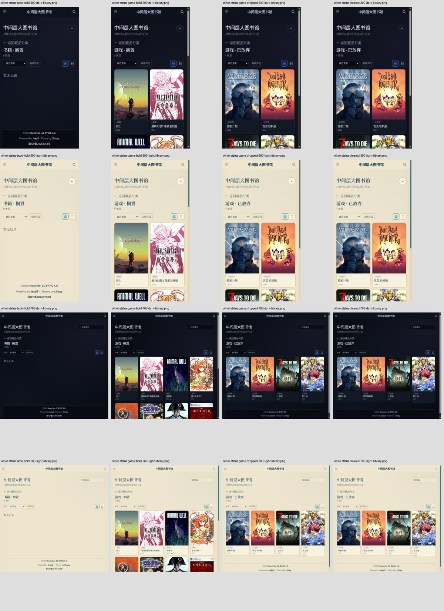
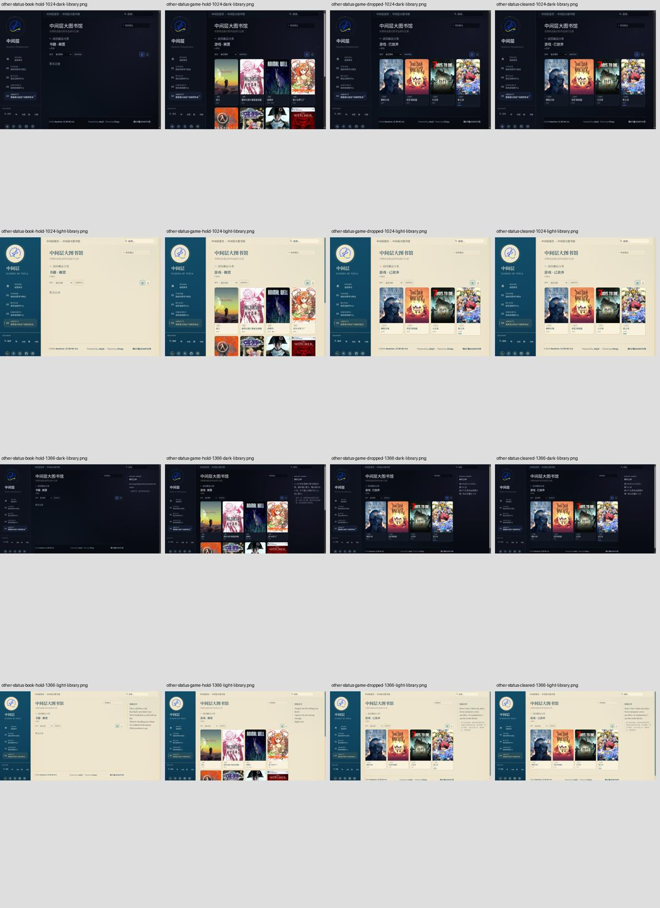

# UI-A08f：Library 搁置与已放弃

状态：限定done（精确main线上验收见文末）。初始Base main `40824656997ec79b0bfe875b33705acef33e65f1`；以下保留阶段pending历史。保留新增用户首页推荐修改，不改产品或数据。

2026-10-16云Chrome1363×936、Prospero Light实际操作：书籍搁置为空时显示“暂无记录”；返回根目录进入游戏，9条搁置刷新保持，切换已放弃4条记录（实际category均game）；清除筛选后仍为已放弃，返回按钮回到分类根。未确认新产品显示缺陷；这些数量仅当前观察，不作未来同步硬编码。

清除筛选按既有源码保留status，只重置source/year/sort/page；不为审计改变产品语义。ID前缀不作为category依据，核对实际data-category。

新增Selenium审计每种宽度/主题book-hold/game-hold/game-dropped/cleared四张PNG及实际几何JSON，共32图，验证状态与category隔离、可见标签/空提示、三次整页刷新URL/ID、清除保留状态并恢复其默认排序、返回根/书籍原ID；保留192+14和原门禁。空书籍将来有记录时核对真实状态/标签，不伪造空数据；游戏使用当前真实非空记录，不写死数量。

本地226 tests、authoring44/5/7、T01保护44/5/5、diff check通过。接线单测不作视觉验收；本机未运行Ruby/Jekyll/Chrome。新head production192+14、32图人工查看和main/live仍pending，先保存工作分支ui/audit-008f，不合main。gh未安装未创建或编造Issue，无新用户决策；完整库存/离屏加载、Steam排序、愿望单/评分控件及其他全站矩阵仍待验收。

## 2026-10-16 生产验收

验收head `63bb246c655ffba55df566daf6dcda7c4f0e11c0`，[run38821881510](https://github.com/AplusNeutrino/My_Blog/actions/runs/38821881510) build116720567164 success；deploy116723405622/live116723406291 skipped（工作分支，不作部署）。226 tests、4 Ruby、T01/authoring44/5/7、production Jekyll/旧门禁及192+14通过。

下载artifact12013457997 /187646207 bytes，sha256 `f5f78f266281992611241327717fc6bcef595abb2a215cdf4ad9ddc5e50b850c` 独立匹配。人工看以下32张四宽度双主题图，放大390 Light空提示、390 Night已放弃、1024 Light搁置原图；空提示、标题、标签与卡片可见，未新增确认产品缺陷。

[完整192 audit](uia08f-production-audit.json)中8组otherStatus流程通过：三种状态刷新同URL/ID、category/status隔离、清除保留status并恢复其默认排序、返回根及书籍原ID。[32几何诊断](uia08f-production-other-status.json)无页面/card横向溢出、scrollX=0；原PNG留artifact14天，联系表/JSON持久保存。

生产验收通过，交付main后仍validation-pending，必须核对实际新main部署/live及同32图，不能用localhost代替。完整库存/离屏加载、Steam排序、愿望单/评分控件及其他全站矩阵未验收；无新用户决策，不改产品、数据或用户首页推荐。

## 2026-10-16 精确main线上验收

验收main `7225dcca0015509cac855c7283a9d793257c8683`，[run38827719864](https://github.com/AplusNeutrino/My_Blog/actions/runs/38827719864) build116738970873/deploy116741229180/verify-live-ui116741300079全部success。226 tests、4 Ruby、T01/authoring44/5/7、production Jekyll/旧门禁及production/live各192+14通过；live job明确 `UI_LIVE_BASE=https://neutriverse.uk`。

下载live artifact12015679614 /187484694 bytes，sha256 `4dd9814cb4adbff941fe2d66c8e775b22e94aa3b7ba96f5c6d1519a46535bf2e` 独立匹配。人工看以下32张四宽度双主题同状态图，放大390 Light空提示、390 Night搁置、1024 Light清除原图；空提示、状态标题/标签及卡片可见，和生产同状态一致，未新增确认缺陷。

[线上192 audit](uia08f-live-audit.json)的8组otherStatus流程通过：书籍搁置空提示及刷新、游戏搁置/已放弃刷新URL/ID、状态/category隔离、清除保留状态并恢复其默认排序、返回根/书籍原ID。[32几何诊断](uia08f-live-other-status.json)无页面/card横向溢出、scrollX=0；原PNG留artifact14天，公开联系表/JSON持久保存。

UI-A08f限定done。完整库存/离屏加载、Steam排序、愿望单/评分控件与其余全站矩阵未验收，新文档head CI另核对，无新用户决策。不改产品/数据、用户首页推荐或旧COMPLETE历史。
