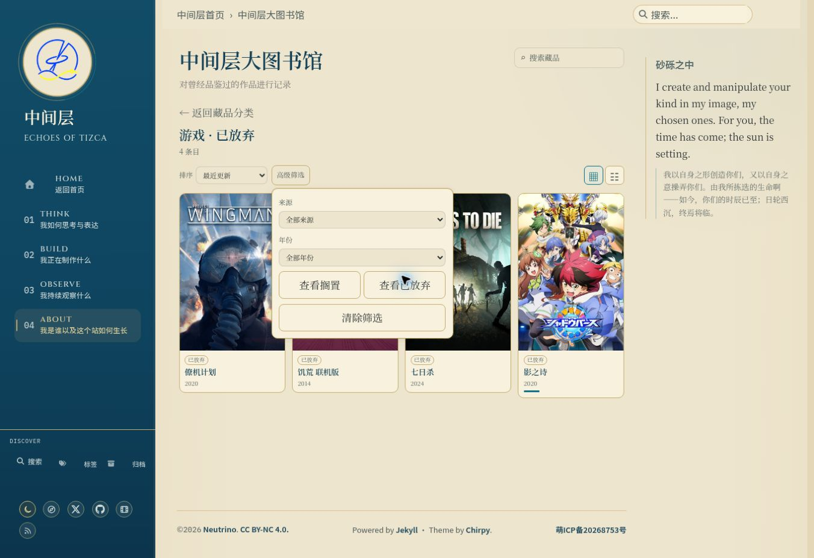

# UI-A08f：Library 搁置与已放弃

状态：validation-pending。Base main `40824656997ec79b0bfe875b33705acef33e65f1`，保留新增用户首页推荐修改，不改产品或数据。

2026-10-16云Chrome1363×936、Prospero Light实际操作：书籍搁置为空时显示“暂无记录”；返回根目录进入游戏，9条搁置刷新保持，切换已放弃4条记录（实际category均game）；清除筛选后仍为已放弃，返回按钮回到分类根。未确认新产品显示缺陷；这些数量仅当前观察，不作未来同步硬编码。

清除筛选按既有源码保留status，只重置source/year/sort/page；不为审计改变产品语义。ID前缀不作为category依据，核对实际data-category。

新增Selenium审计每种宽度/主题book-hold/game-hold/game-dropped/cleared四张PNG及实际几何JSON，共32图，验证状态与category隔离、可见标签/空提示、三次整页刷新URL/ID、清除保留状态并恢复其默认排序、返回根/书籍原ID；保留192+14和原门禁。空书籍将来有记录时核对真实状态/标签，不伪造空数据；游戏使用当前真实非空记录，不写死数量。

本地226 tests、authoring44/5/7、T01保护44/5/5、diff check通过。接线单测不作视觉验收；本机未运行Ruby/Jekyll/Chrome。新head production192+14、32图人工查看和main/live仍pending，先保存工作分支ui/audit-008f，不合main。gh未安装未创建或编造Issue，无新用户决策；完整库存/离屏加载、Steam排序、愿望单/评分控件及其他全站矩阵仍待验收。
