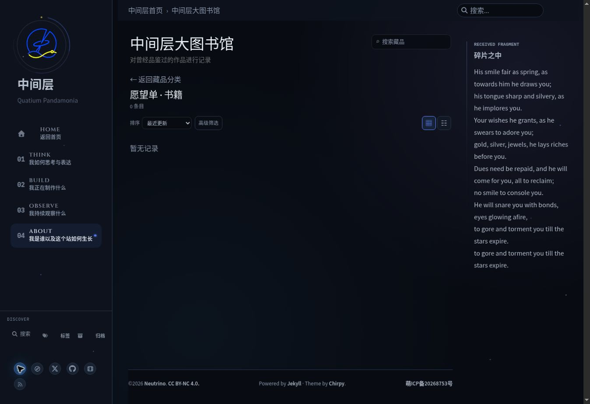
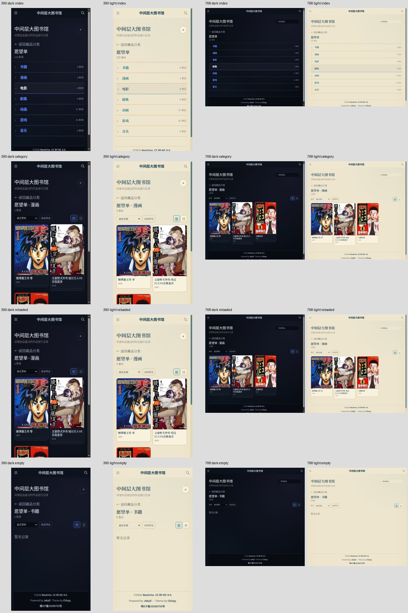
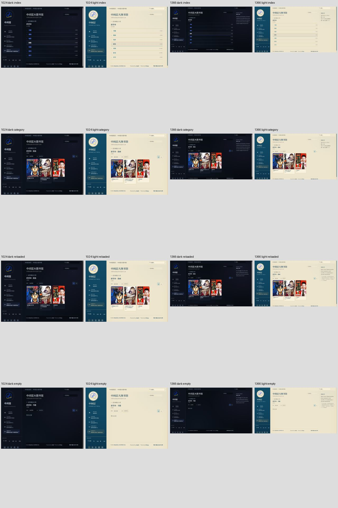

# UI-A08g：Library 愿望单

状态：生产验收通过、main/live validation-pending。Base main `23343d67baba17dbe787f5611eea39ed90ad0b79`；只补真实浏览器审计与证据，未确认新产品缺陷，不改样式/数据。以下保留初始pending历史。

2026-10-16云Chrome1363×936实际操作：Prospero Light愿望单目录含七分类，漫画3项可打开、刷新同URL/ID、封面加载完成可见，返回仍是愿望单目录；书籍0项有“暂无记录”，刷新保持，再切到Night确认空提示可见。两级返回确实回Library根URL。数量仅当前观察，不写死未来同步数目；首次异步封面尚未完成不作永久缺失结论。

新增Selenium审计四宽度双主题目录/非空分类/刷新/空分类四状态，当前预计32张PNG与几何JSON，8条真实流程；目录计数来自当前DOM，选最少非空分类及真实零分类，若未来无零分类则明确emptyCategory=null、不伪造空数据。验证计数合计、category/status隔离、刷新URL/ID、空提示、两级返回及书籍原ID恢复。保留192+14与现有门禁。根目录隐藏card-view，不把不可见残留卡片当已显示。

本地227 tests、authoring44/5/7、T01保护44/5/5及diff check通过；接线单测不是视觉验收。本机未运行Ruby/Jekyll/Chrome，production四宽度双主题新32图与main部署/live仍pending，保存ui/audit-008g，不合main。评分控件、完整库存/离屏加载、Steam及其余全站项仍pending，无新用户决策；gh未安装，不编造Issue。

## 2026-10-16 生产验收

验收head `8240a3b192e32b935541208532fd491cd3b75033`，[run38838899369](https://github.com/AplusNeutrino/My_Blog/actions/runs/38838899369) build116774445703 success；deploy116776769147/verify-live-ui116776770483 skipped（工作分支，不作部署）。227 tests、4 Ruby、T01/authoring44/5/7、production Jekyll/旧门禁及192+14通过。

下载artifact12020114567 /198131424 bytes，sha256 `ff71298bccc979568bc672d6c06ee426059a9be228bba4803efacc64e215ed69` 独立匹配。人工看以下32张四宽度双主题index/category/reloaded/empty图，放大390 Light刷新长标题、390 Night目录、1024 Light空提示原图，计数/封面/标题/空提示可见，未确认新显示缺陷。

[完整192 audit](uia08g-production-audit.json)中8组wishlist流程目录计数、category/status隔离、整页刷新同URL/ID、真实空提示/刷新、两级返回与书籍原ID恢复通过。[32几何诊断](uia08g-production-wishlist.json)均无页面/元素横向溢出、scrollX=0。当前非空comic、空book来自真实数据，不写死未来数量，未验收离屏封面或完整库存；原PNG留artifact14天。

生产验收通过，交付main后仍validation-pending，必须新main部署/live同32图复验。评分控件、Steam及其余全站项未验收，无新用户决策，不改产品/数据/旧COMPLETE。
