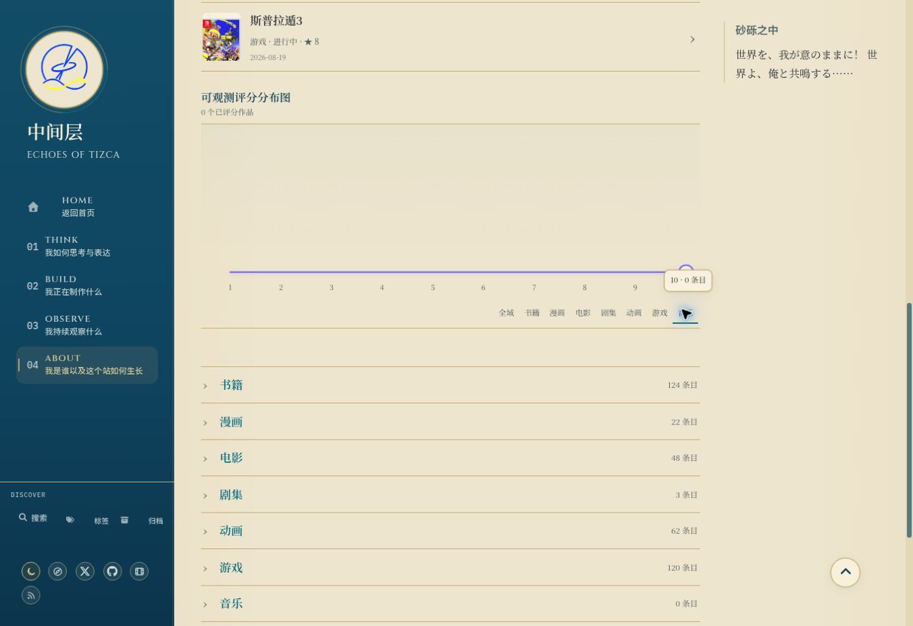

# UI-A08h：Library 评分控件

状态：validation-pending。Base main `3d822d563af3b798a98887d3f35505496931d63c`。仅浏览器审计/回归/证据，不改产品或数据，未确认新显示缺陷。

2026-10-16云Chrome1363×936 Prospero Light实际操作书籍与音乐分类：书籍21个已评分作品、均值7.5、峰值7；音乐0项并显示水平零线。数目只为当前观察，不硬编码未来同步。Shift+Tab从全域按钮进入末端点，真实activeElement为评分10 circle，提示“10 · 0 条目”显示在viewport内。

新增Selenium审计四宽度双主题八分类切换，逐项对照当前仓库stats分布核对十个分箱、摘要总数/均值/峰值及单一active分类；非空书籍/音乐状态、键盘首末端提示共32张截图与几何JSON。通过真实Shift+Tab/Tab遍历首末端与退出隐藏，不调用focus/dispatchEvent伪造；刷新按既有非URL控件契约恢复默认全域，不擅自增加持久化功能。保留192+14及全部门禁。

本地228 tests、authoring44/5/7、T01保护44/5/5、diff check通过。云真实Tab从末端点退出到全域按钮后tooltip.hidden=true。

Production32图、8流程、main部署/live同场景尚未验收，先ui/audit-008h，不合main；不把接线单测当视觉通过。本机未运行Ruby/Jekyll/Chrome。完整库存/离屏加载、Steam与其他全站项仍pending，无新用户决策；gh未安装，不编造Issue。
